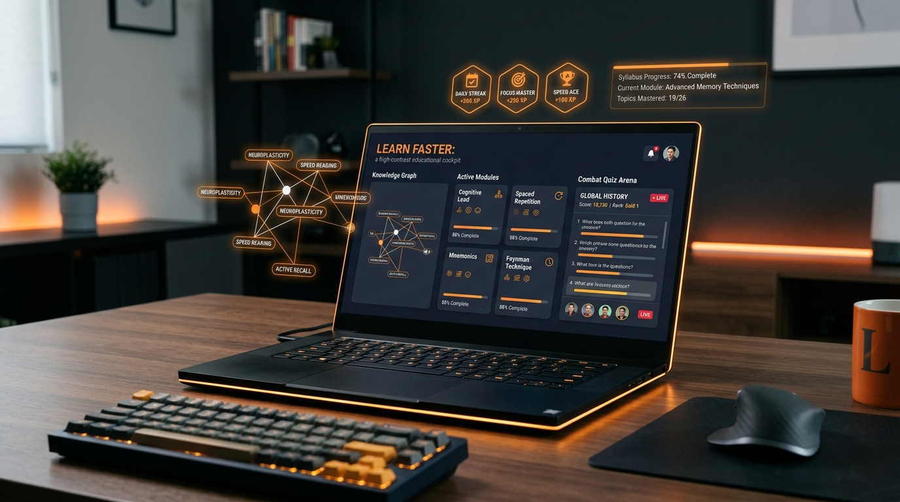

# Learn Faster ⚡

<p align="center">
  
</p>

<p align="center">
  <strong>Transform chaotic lecture slides, notes, and transcripts into high-yield concept maps and combat quiz arenas.</strong>
</p>

<p align="center">
  
  
  
  
  
  
</p>

---

## 💡 Overview

Students and self-directed learners frequently spend 80% of their study time passively re-reading 50-slide decks or skimming endless lecture recordings, leading to cramming and rapid forgetting. Standard AI summarizers only produce more dry walls of text.

**Learn Faster** turns passive study materials into an active, game-inspired learning experience:
1. **Synthesizes** unstructured lecture notes and transcripts into structured, high-yield takeaways.
2. **Maps** core dependencies into an interactive visual **Knowledge Graph**.
3. **Challenges** comprehension with an interactive **Combat Quiz Arena** that rewards XP and isolates weak topics.

---

## ✨ Key Features

- 🎯 **Tactical Lecture Synthesis**: Instant executive briefs, core formulas, essential definitions, and practical intuition without fluff.
- 🧠 **Interactive Knowledge Graph**: Dynamic node-link visualization displaying conceptual hierarchies, prerequisite pathways, and topic relationships.
- ⚔️ **Combat Quiz Arena**: Fast-paced active recall testing with instant answer validation, comprehensive explanations, and performance scoring.
- 📈 **Exam Readiness Radar**: Real-time diagnostic progression tracking that identifies high-impact weak topics before test day.
- 🔌 **Modular AI Architecture**: Pluggable provider system supporting modern cloud inference (Google Gemini) and 100% offline, zero-marginal-cost local inference via open-weight models (Ollama / Qwen2.5 7B).
- ⚡ **Real-Time Streaming**: Server-Sent Events (SSE) telemetry showing live multi-step analysis progress (`Parsing` → `Synthesizing` → `Extracting Graph` → `Generating Quizzes`).

---

## 🛠️ Tech Stack

### Frontend
- **Framework:** React 19 + TypeScript
- **Bundler:** Vite
- **Styling:** Tailwind CSS (Custom Neo-Brutalist design tokens)
- **Visuals & 3D:** Three.js / Canvas 3D interactive hero
- **Icons:** Lucide React

### Backend
- **Runtime:** Node.js + Express
- **Protocol:** Server-Sent Events (SSE) for real-time progress streaming
- **AI Providers:** Modular AI provider interface (`GeminiProvider`, `OllamaProvider`)
- **JSON Pipeline:** Fault-tolerant JSON parser with automatic error recovery and schema verification

---

## 🚀 Quick Start

### 1. Clone the Repository
```bash
git clone https://github.com/Daks9h/learn-faster.git
cd learn-faster
```

### 2. Install Dependencies
Install both frontend and backend dependencies:
```bash
# Install root (frontend) dependencies
npm install

# Install server (backend) dependencies
cd server
npm install
cd ..
```

### 3. Configure Environment Variables

Create `.env` in the root folder:
```env
VITE_API_URL=http://localhost:8787
```
*(Note: When deployed as a unified web service on Render, this variable can be omitted as the client automatically resolves API calls to the same origin.)*

Create `server/.env` in the `server` folder:
```env
PORT=8787
AI_PROVIDER=gemini
GEMINI_API_KEY=your_gemini_api_key_here
GEMINI_MODEL=gemini-3.8-flash
JWT_SECRET=your_secure_jwt_secret_here
```

*(Optional)* For offline local inference with Ollama:
```env
AI_PROVIDER=ollama
LOCAL_AI_URL=http://localhost:11434
LOCAL_MODEL=qwen2.5:7b-instruct
```

### 4. Run Locally
Run both the frontend client and the synthesis server concurrently:
```bash
npm run dev:all
```

- **Frontend:** [http://localhost:3000](http://localhost:3000)
- **Backend API:** [http://localhost:8787](http://localhost:8787)

---

## 🚀 Deploying to Render (Web Service)

You can deploy **Learn Faster** directly on [Render](https://render.com) as a single, unified Node.js Web Service:

### Option 1: Automatic Blueprint (Recommended)
1. Fork or push this repository to GitHub.
2. In the Render Dashboard, click **New +** → **Blueprint**.
3. Connect your repository. Render will automatically read [`render.yaml`](render.yaml).
4. Enter your `GEMINI_API_KEY` when prompted. Render will automatically generate `JWT_SECRET` and deploy!

### Option 2: Manual Web Service Setup
1. In the Render Dashboard, click **New +** → **Web Service**.
2. Connect your repository and select the **Node** runtime.
3. Configure the service settings:
   - **Build Command:** `npm run build`
   - **Start Command:** `npm start`
   - **Health Check Path:** `/api/health`
4. In the **Environment Variables** tab, add:
   - `NODE_ENV`: `production`
   - `AI_PROVIDER`: `gemini`
   - `GEMINI_MODEL`: `gemini-3.8-flash`
   - `GEMINI_API_KEY`: *(your Google Gemini API key)*
   - `JWT_SECRET`: *(a random 64-character secret)*
5. Click **Deploy Web Service**. Render will build the Vite frontend and Express server together into a single lightning-fast production endpoint!

---

## 📂 Project Structure

```text
learn-faster/
├── assets/
│   └── banner.png             # Project banner & preview
├── public/                    # Static assets & brand icons
├── server/                    # Node.js backend
│   ├── src/
│   │   ├── index.ts           # Express server & SSE endpoints
│   │   ├── prompts/           # Structured analysis & quiz prompts
│   │   ├── providers/         # Gemini & Ollama provider implementations
│   │   └── types.ts           # Schema and payload definitions
│   └── package.json
├── src/                       # React frontend
│   ├── components/            # UI Views (LectureView, QuizView, HomeView, etc.)
│   ├── types/                 # Frontend interfaces
│   ├── App.tsx                # Main view router & state manager
│   └── main.tsx
├── package.json
└── README.md
```

---

## 🛡️ License

This project is licensed under the [MIT License](LICENSE).
